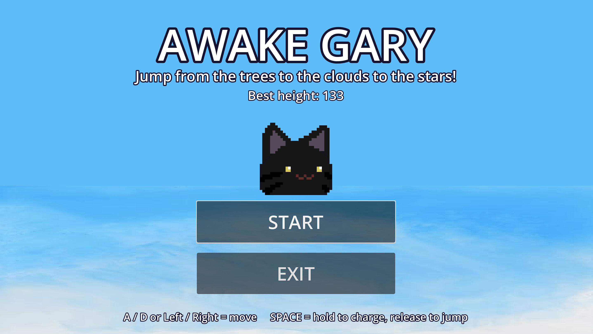

# AwakeGary

A 2D physics-based platformer built in Godot Engine featuring Gary, a cat navigating dynamically spawned obstacles using charge-jump mechanics.

🎮 **Playable Build:** [AwakeGary](https://adibb1.itch.io/awakegary)



## Overview
AwakeGary is a 2D arcade platformer built over 48 hours at **Haven KL** (Hack Club's game jam at Microsoft Malaysia, Menara Shell). Players control Gary, holding and releasing input to charge jumps across varying distances while avoiding incoming obstacles.

## Key Mechanics & Features
- **Charge-Jump Physics:** Variable jump force calculated from hold duration, requiring precise timing and trajectory control.
- **Dynamic Obstacle Spawning:** Procedural obstacle generation that scales pacing and keeps runs unpredictable.
- **2D Sprite Animations:** State-driven `AnimatedSprite2D` transitions for idle, charge-up, mid-air jump, and landing states.
- **Quick Restart Loop:** Instant collision detection, score tracking, and zero-delay run resets.

## Controls
| Action | Input |
| :--- | :--- |
| Move | `A` \ `D` \ `Left Arrow` \ `Right Arrow` |
| Charge Jump (Hold) | `Space` |
| Jump (Release) | Release `Space` |
| Restart Run | `Esc` |

## Tech Stack
- **Engine:** Godot Engine 4
- **Language:** GDScript
- **Art & Audio:** 2D Sprite Sheets & Custom Sound Effects

## Running Locally
1. Clone the repository:
   ```bash
   git clone https://github.com/Adibb1/AwakeGary.git
   ```
2. Open Godot Engine and click Import.

3. Navigate to the cloned folder and select project.godot.

4. Press F5 (or click Run Project) to launch the game.

##Credits
Built by Me, Nabil and Eizdihar during Haven KL 2026.
